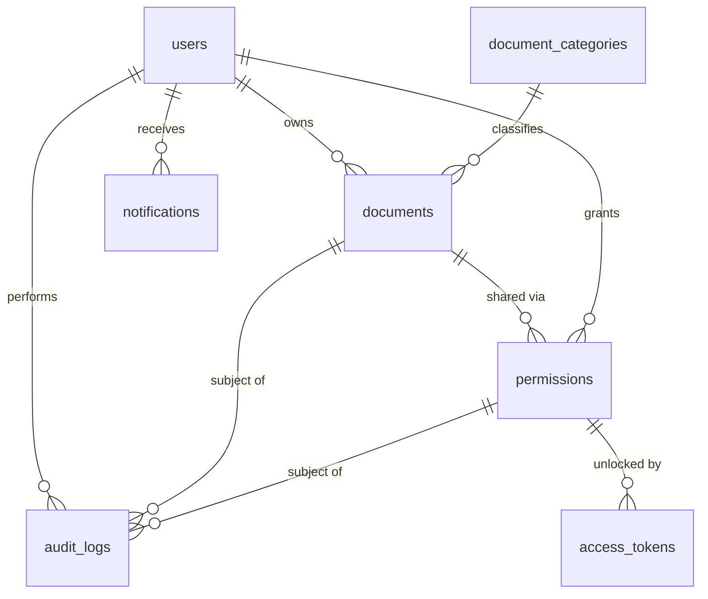

# Database Schema (MySQL 8+)

| Table | Key design notes |
|---|---|
| users | `email` unique + indexed; only `password_hash` stored |
| document_categories | `name` unique; seeded with 7 defaults |
| documents | random `stored_filename` (unique); `encryption_metadata` JSON (nonce/algorithm, never the key) |
| permissions | `permission_type` VIEW_ONLY / VIEW_AND_DOWNLOAD, `status` ACTIVE / EXPIRED / REVOKED, indexed `expires_at` |
| access_tokens | only `token_hash` (SHA-256 hex, unique, indexed); raw token is never stored |
| audit_logs | `user_id`, `document_id`, `permission_id` are SET NULL on delete so history survives |
| notifications | per-user, `is_read` flag |

Timestamps are stored as naive **UTC** datetimes.
